> **Para quem é:** o dono do produto / analista de negócio.
> **O que é:** o mapa dos dois módulos da 1ª versão, escrito do ponto de vista de quem usa em obra nos EUA. As telas são as reais do app (capturas de 25/10/2026, dados de exemplo).
> **Fontes técnicas já existentes:** `docs/measure.md` (Takeoff), `docs/concorrencias.md` (Licitações, regras CO-01 a CO-25), `docs/cronograma.md` e `docs/obras.md`. Este documento **não substitui** esses; ele organiza, aponta a confusão e propõe o ajuste.
> **Estado:** proposta para validação. Nada foi alterado no código por causa dele.

# 1. Resumo para decisão

**O que o produto faz hoje, em uma frase:** a empresa mede a planta (Takeoff), transforma as medidas em materiais e preço (assemblies e preços), emite a proposta ao cliente e, quando quer terceirizar parte do serviço, convida prestadoras para cotar (Licitação, ou *bid*) e compara as respostas lado a lado.

**Os cinco achados mais importantes:**

1. **A base está certa e é competitiva.** O ciclo medir → materiais → proposta → licitar → comparar → fechar existe de ponta a ponta. A combinação (takeoff + assemblies + bid leveling no mesmo lugar) é o que costuma exigir dois ou três produtos separados no mercado.
2. **A confusão é de linguagem e de caminho, mais que de função.** O mesmo objeto tem vários nomes (Measure / Takeoff, Concorrência / Convite / Bid) e há dois menus para a mesma coisa (Convites e Concorrências).
3. **O "para quem é o projeto" mistura dois sentidos de "contratante".** No projeto, é o cliente que pediu a *sua* proposta. Na licitação, é quem convida. Mesma palavra, papéis opostos.
4. **Faltam dois caminhos que o seu fluxo exige:** licitar *sem* o KOR (pacote para e-mail e registro manual da resposta) e o **aceite** (responder sim, sem proposta nova).
5. **O cronograma entra tarde.** Hoje nasce na obra, depois de ganhar. No seu fluxo ele nasce na proposta e é **confirmado ou ajustado** no ganho.

**O que eu recomendaria fazer primeiro** (detalhado no capítulo 9): padronizar os nomes e o menu (barato e de alto efeito), ajustar o cadastro do projeto, fechar os dois caminhos que faltam na licitação, e só então levar o cronograma preliminar para o projeto.

# 2. Vocabulário (EUA): o inglês é a fonte dos nomes

**Decisão (25/10/2026):** os nomes das telas são definidos **em inglês**, no uso corrente da obra privada nos EUA. O português existe só para facilitar a homologação e acompanha o inglês.

| Conceito | Inglês (fonte) | Português (apoio) |
|---|---|---|
| Medir a planta e quantificar | **Takeoff** | Takeoff |
| Conjunto de materiais por tipo de medida | **Assembly** | Assembly |
| Quem pediu a minha proposta | **Client** | Cliente (quem pediu a proposta) |
| Dono final, quando é outra pessoa | **Project owner** (optional) | Dono da obra (opcional) |
| Módulo e item de menu | **Bids** (abas **Sent** e **Received**) | Licitações (Enviadas e Recebidas) |
| O que a prestadora recebe | **Bid invitation** (*Invitation to Bid*, ITB) | Convite para cotar |
| Conjunto de escopo, documentos e prazos | **Bid package** | Pacote da licitação |
| Botão de quem licita | **Invite to bid** / **Send invitations** | Enviar convites |
| Prazo | **Bid due date** | Prazo da proposta |
| Resposta da prestadora | **Bid** | Proposta |
| Quem licita | **Inviting company** | Quem licita |
| Quem recebe e cota | **Subcontractor** | Prestadora |
| Comparar as respostas | **Compare bids** (*bid leveling*) | Comparar propostas |
| Dúvida durante a licitação | **RFI** / Questions | Perguntas |
| Escolher a vencedora | **Award** (situações: **Awarded**, **Not awarded**, **Canceled**) | Contratar |
| Alteração depois do envio | **Addendum** | Adendo |
| Pedido de preço de material | **RFQ** | Pedido de cotação de material |

**Já aplicado no app (25/10/2026):** menu único **Bids** (Licitações) com as abas **Sent** e **Received**; cadastro do projeto com **Client** e **Project owner (optional)**; abas da licitação com **Compare bids**; situação **Not awarded**; "inviting company" no lugar de "contracting company". **Ainda por aplicar:** o português do corpo das telas (que ainda diz "Concorrência"), a revisão do inglês tela a tela e o idioma de entrada em inglês.

# 3. Quem participa

| Papel | O que faz | Exemplo |
|---|---|---|
| **Empresa que orça** (estimadora) | Mede, orça, emite a proposta ao cliente. Pode também licitar parte do serviço. | Prestadora de siding que orça uma casa |
| **Cliente** | Pediu a proposta. Pode ser construtora (GC) ou o dono do imóvel. | Thompson Family; uma construtora |
| **Dono da obra** | Só existe quando o cliente é uma construtora e o dono final é outro. | Dono do imóvel |
| **Prestadora convidada** | Recebe a licitação, cota, aceita ou recusa. Pode ter ou não conta no KOR. | Drywall, pintura, telhado |
| **Fornecedor** | Recebe o pedido de cotação de **material** (e-mail e PDF). Hoje é separado da licitação. | Lumber yard, paint supply |

**A cadeia pode se repetir:** uma prestadora que ganha pode licitar parte do serviço para outras (*quarteirização*). As telas e as regras são as mesmas.

# 4. Mapa dos módulos e como se ligam

```
                      ┌──────────────────────────── SETTINGS ────────────────────────────┐
                      │ Empresa · Contatos (clientes, prestadoras, fornecedores) · Obras  │
                      └───────────────┬───────────────────────────────┬──────────────────┘
                                      │ alimenta                      │ alimenta
   ┌───────────── TAKEOFF ─────────────▼─────────────┐   ┌───────────▼──────── LICITAÇÕES (BID) ─────────────┐
   │ Projeto → Folhas (PDF) → Condições medidas      │   │ Pacote → Convidados → Respostas → Comparar → Fechar │
   │        → Assemblies → Itens e Preços            │   │      ▲                                              │
   │        → Materiais e mão de obra                │   │      │ escopo, etapas, desenhos                      │
   │        → Lista para cotação (fornecedor)        │───┼──────┘                                              │
   │        → Proposta ao cliente (PDF, margens)     │◄──┼── "Usar no meu orçamento" (preço da prestadora)     │
   └─────────────┬───────────────────────────────────┘   └───────────────┬─────────────────────────────────────┘
                 │ projeto Ganho                                         │ quem recebe, com conta
                 ▼                                                       ▼
          Criar obra (cronograma)                              vira um projeto no Takeoff dela
```

**Em português simples:** o *Takeoff* produz o orçamento e a proposta. A *Licitação* usa o escopo e os desenhos do projeto para pedir preço a quem vai executar parte do serviço, e devolve esse preço para dentro do orçamento. *Settings* guarda quem é cada pessoa e empresa.

# 5. Fluxo ponta a ponta

## 5.1 Visão geral (o seu fluxo, com o que existe hoje)

| # | Quem | O que acontece | Situação hoje |
|---|---|---|---|
| 1 | Empresa A | Elabora o projeto: envia as plantas (PDF), define escala, mede, aplica assemblies, vê materiais e preços. | **Pronto** |
| 2 | Empresa A | Informa **para quem é a proposta** (cliente e, se houver, dono da obra). | **Pronto**, mas confuso (§8) |
| 3 | Empresa A | Decide **licitar** parte do serviço e monta o pacote (escopo, etapas, documentos, prazos, exigências, convidados). | **Pronto** |
| 4a | Empresa A | Envia **pelo KOR** (com conta recebe dentro do sistema; sem conta recebe por link no e-mail). | **Pronto** |
| 4b | Empresa A | Envia **por e-mail, sem o KOR** (pacote para baixar e registro manual da resposta). | **Falta** |
| 5 | Prestadora sem conta | Abre o link, vê pacote e documentos, pergunta, manda proposta (PDF e total) ou recusa. | **Pronto**; falta o **aceite** |
| 6 | Prestadora com conta | "Vou cotar" cria um **projeto** no Takeoff dela, com os desenhos e o cliente já preenchidos, e segue o fluxo normal. | **Pronto** |
| 7 | Empresa A | Compara as propostas lado a lado, pergunta, fecha com uma (as outras são avisadas, sem ver o valor da vencedora). | **Pronto** |
| 8 | Empresa A | Se as duas têm conta, vê a prestadora em **nível gerencial**. | **Parcial** (vê a proposta, não o andamento do projeto dela) |
| 9 | Empresa A | Ganha o projeto: confirma o cronograma e cria a obra. | **Parcial** (o cronograma nasce na obra, sem o preliminar) |

## 5.2 Estados

**Projeto (Takeoff):** `Em orçamento` → `Proposta enviada` → `Ganha` ou `Perdida`. O prazo da proposta só alerta enquanto está em orçamento.

**Licitação:** `Rascunho` → `Aberta` → `Para fechar` (prazo vencido) → `Fechada` (com vencedora) ou `Cancelada`. Prorrogar volta de *Para fechar* para *Aberta*.

**Convite (por prestadora):** `Enviado` → `Visto` → `Vai cotar` ou `Não vai participar` → `Proposta enviada` (rev. 1, 2…) → `Vencedora` ou `Não escolhida`.

# 6. Módulo Takeoff

## 6.1 O que ele resolve

Transformar uma planta em PDF em **quantidades**, **materiais** e **preço**, com rastro de cada número (da medida até a fórmula). Medir é sempre sobre a geometria desenhada, nunca digitado.

## 6.2 Fluxo de trabalho

1. **Projeto:** nome, tipo de obra, situação, escopo, cliente, local, prazo da proposta, estimador.
2. **Folhas:** enviar o PDF; cada página vira uma folha com a sua escala (da lista ou por calibração), com conferência.
3. **Condições:** o que se mede (linear, área ou contagem). Entram pelo catálogo de assemblies; cada uma tem cor, propriedades (altura, espessura, inclinação, vãos a descontar).
4. **Medição no visor:** ferramentas Mover, Medir, Recortar, Vão e Typical (repetição de folha).
5. **Quantidades e materiais:** as condições alimentam os assemblies, que geram itens com perda e arredondamento.
6. **Preços e margens:** preço por item com histórico; margens (overhead, lucro, imposto).
7. **Lista para cotação:** itens por fornecedor, PDF e e-mail preparado, registro dos preços recebidos.
8. **Proposta:** linhas por etapa, PDF numerado e congelado; revisões.

## 6.3 Telas atuais

**Lista de projetos** — situação, prazo (com alerta), estimador e número de folhas.

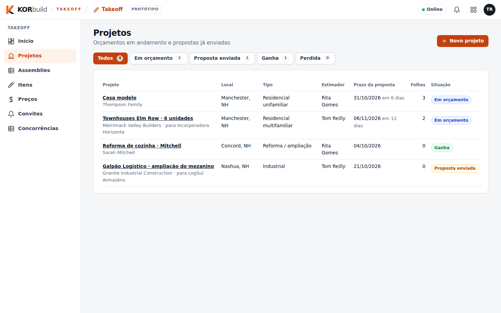{ width=100% }

**Cadastro do projeto** — o bloco "Para quem é a proposta" é o que gerou a dúvida (§8, item 3).

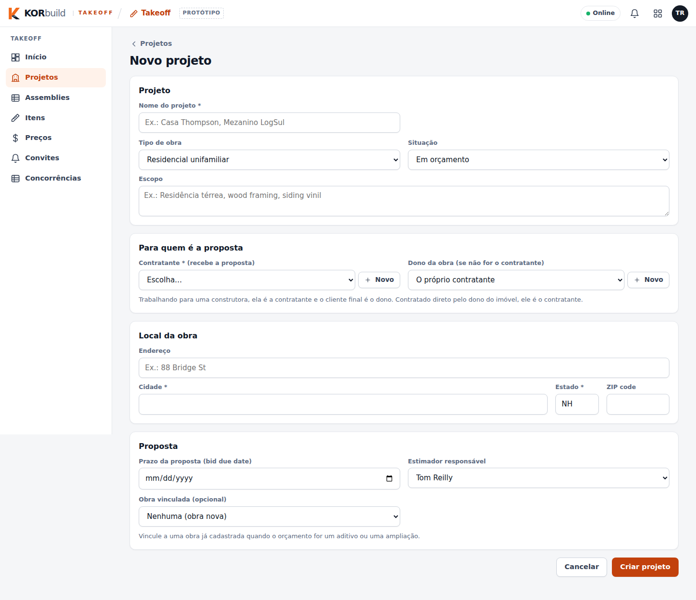{ width=100% }

**Página do projeto** — folhas, quantidades, materiais e os atalhos Lista para cotação, Proposta e **Nova concorrência** (licitar com as suas prestadoras).

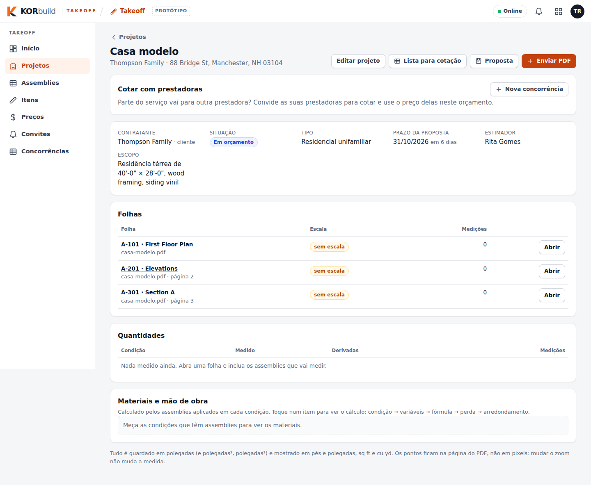{ width=100% }

**Visor da folha** — a planta no centro, as condições à esquerda e a barra de ferramentas.

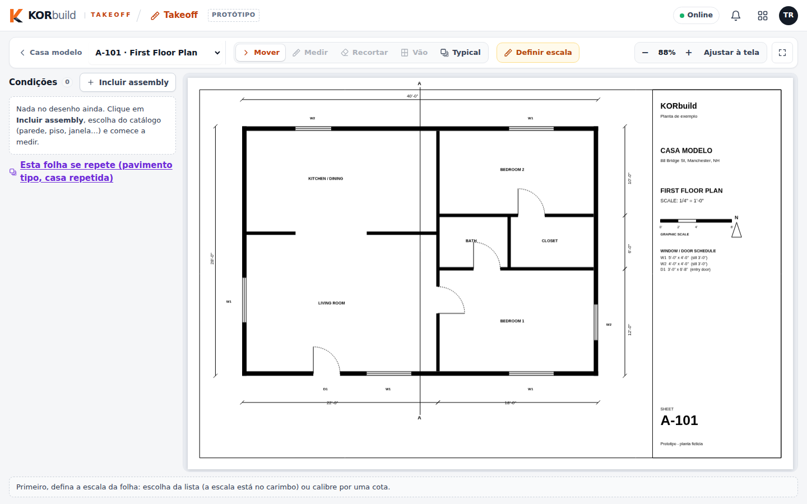{ width=100% }

**Assemblies, editor e itens** — o coração do orçamento: fórmula, perda e arredondamento visíveis.

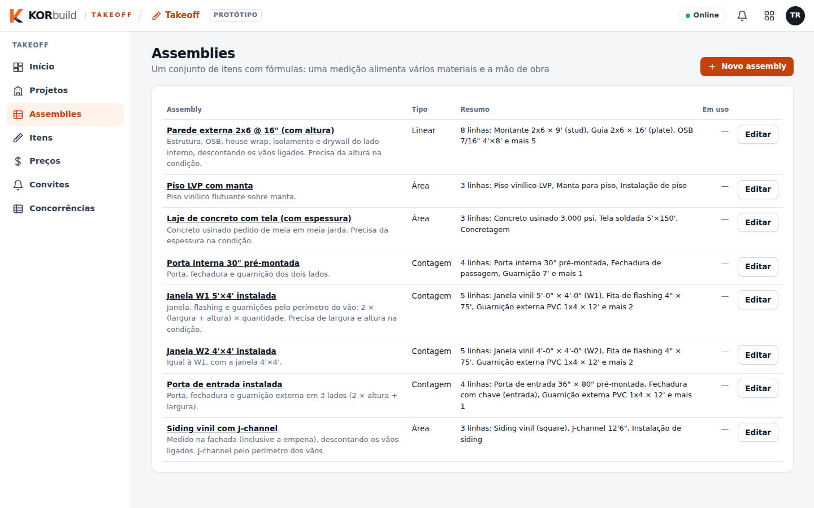{ width=100% }

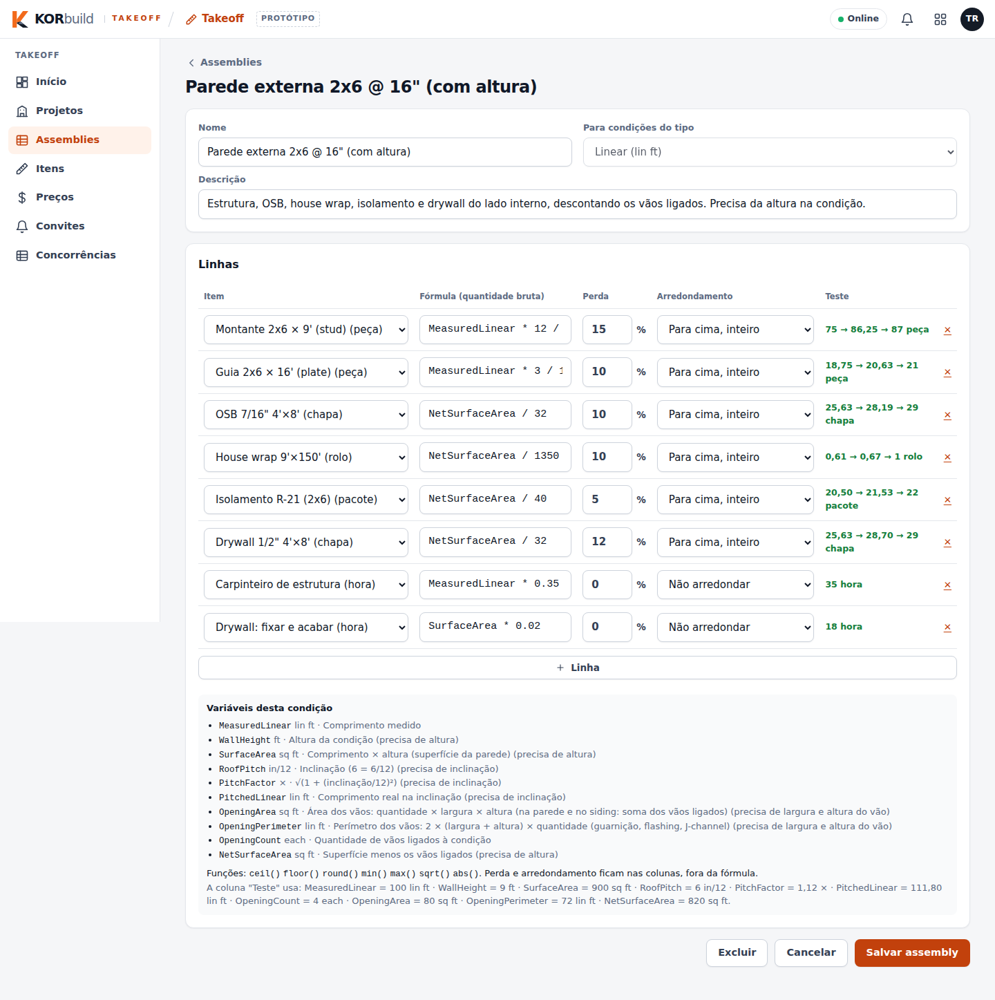{ width=100% }

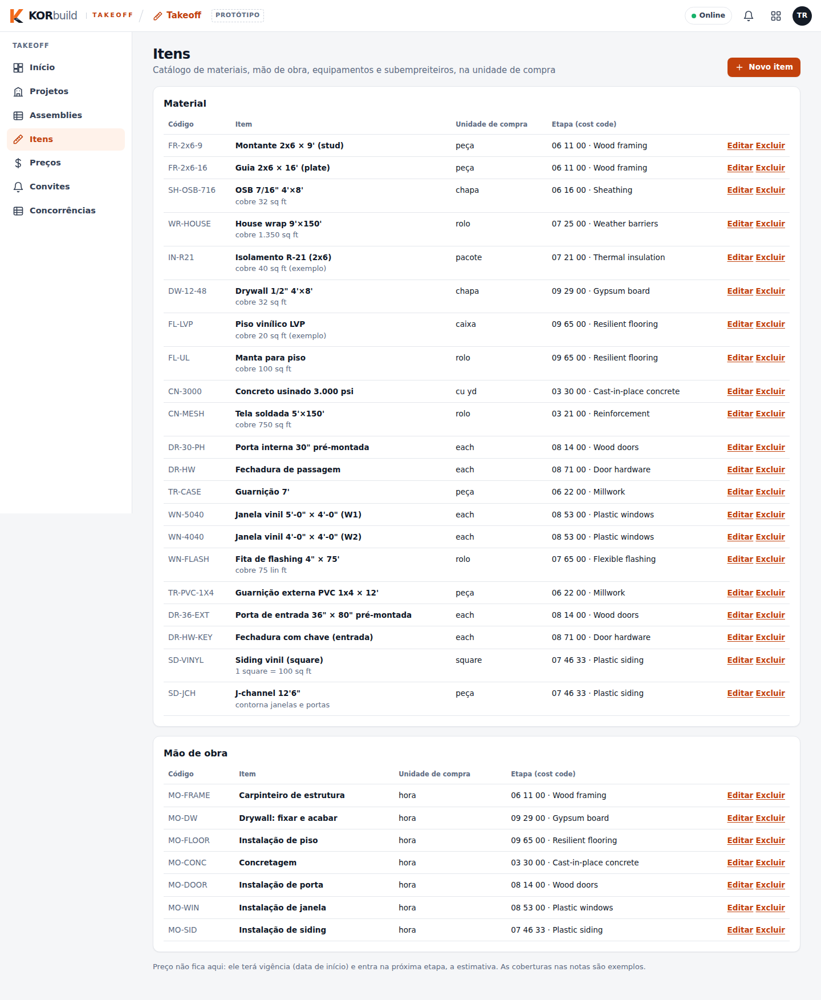{ width=100% }

**Lista para cotação, proposta e preços**

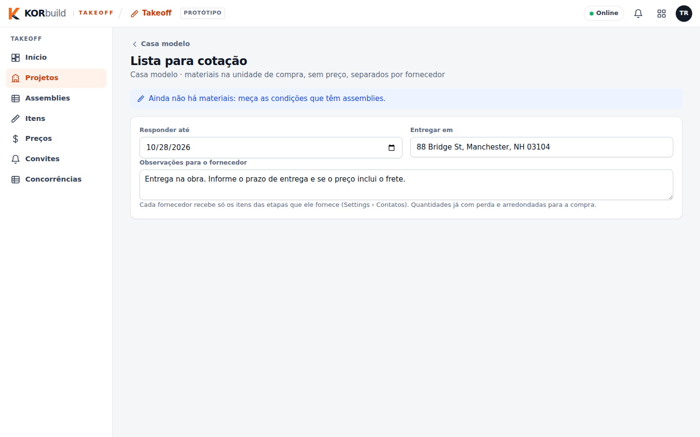{ width=100% }

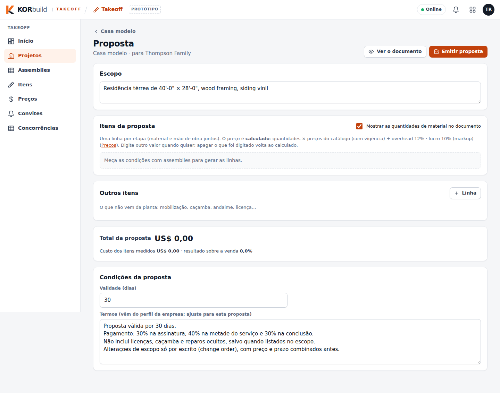{ width=100% }

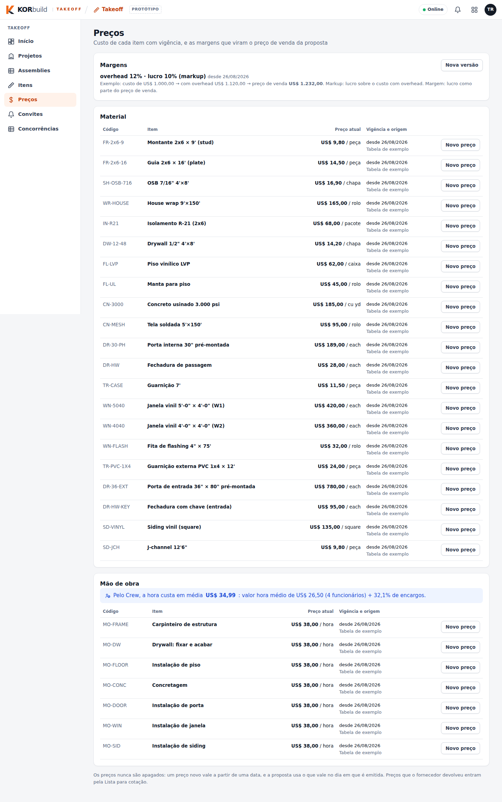{ width=100% }

## 6.4 Regras principais (resumo; a lista completa MZ-01 a MZ-33 está em `docs/measure.md`)

| Tema | Regra |
|---|---|
| Unidades | Tudo guardado em polegadas e exibido em pés e polegadas; o arredondamento é só de tela. |
| Pontos | Ficam em coordenadas da página do PDF, nunca em pixels: zoom não muda a medida. |
| Escala | Da folha, pela lista ou por calibração, com conferência (diferença acima de 1% é marcada). |
| Medida | Sempre calculada da geometria; nunca digitada (rastreável até a planta). |
| Assembly | Uma medição alimenta vários itens; fórmula só calcula a bruta; perda e arredondamento são colunas próprias. |
| Fórmulas | Motor seguro com lista de variáveis e funções permitidas; erro diz a linha. |
| Vãos | Janelas e portas contadas descontam de parede e siding; vão desenhado recorta a área e conta +1. |
| Folhas | Cada condição só aparece na folha onde foi incluída; dá para reaproveitar em outra. |
| Projeto | Nome, cliente, cidade e estado são obrigatórios; excluir apaga folhas e medições. |
| Preço | Histórico com origem (cotação, digitado) e vigência; margens com vigência; proposta emitida é congelada. |
| Visibilidade | Dinheiro só para quem tem permissão de catálogo ou de custos. |

## 6.5 O que o mercado oferece e onde estamos

*(Conhecimento geral do mercado, sem pesquisa nesta sessão. Convém conferir antes de usar em material comercial.)*

| Capacidade | Referências no mercado | KORbuild hoje |
|---|---|---|
| Medir em PDF com escala | Bluebeam Revu, PlanSwift, On-Screen Takeoff, STACK | Sim |
| Assemblies / listas de materiais | PlanSwift, STACK, ProEst | Sim, com cálculo à vista |
| Detecção automática por IA | Togal.AI e similares | Não |
| Comparar revisões de planta (sobreposição) | Bluebeam, STACK | Não |
| Exportar para Excel | Todos | **Não** (prioridade já definida por você) |
| Biblioteca inicial de itens e assemblies | Comum | Parcial (dados de exemplo) |
| Bid management (convites, comparação) | BuildingConnected, Procore Bid Management | Sim, integrado ao orçamento |

# 7. Módulo Licitações (Bid)

## 7.1 O que ele resolve

Pedir preço a prestadoras para parte do serviço, **com o mesmo pacote para todas**, comparar as respostas com justiça (etapa não cotada nunca vira zero) e **fechar** com uma, de forma registrada.

## 7.2 Fluxo

1. **Montar o pacote:** serviço, etapas (cost codes), escopo incluso e excluso, documentos (PDF), prazos, orçamento (mostrar ou não), exigências, convidados.
2. **Salvar** (rascunho) e **Enviar convites** (só depois de salvar, e só com o que falta preenchido).
3. **Respostas:** Vou cotar / Não vou participar / Proposta (com revisões até o prazo) / Perguntas.
4. **Comparar:** colunas por prestadora, linhas por etapa, menor valor por etapa, exclusões que contradizem o escopo.
5. **Fechar:** escolhe a vencedora; as outras são avisadas, sem ver o valor.
6. **Depois:** a vencedora com conta já tem o projeto; a obra nasce ligada.

## 7.3 Telas atuais

**Lista** — situação, prazo, convidados e propostas recebidas, com a coluna Ações.

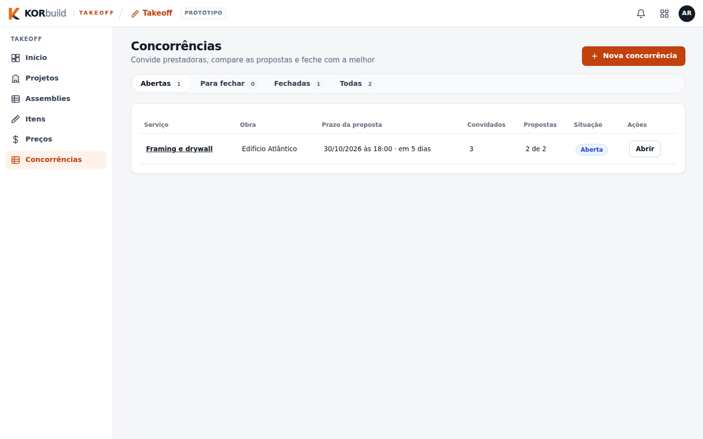{ width=100% }

**Nova concorrência** (formulário em abas)

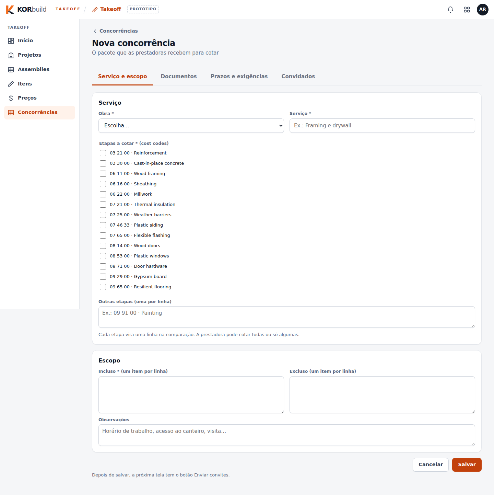{ width=100% }

**Página da licitação** — convidados, perguntas, comparar e detalhes.

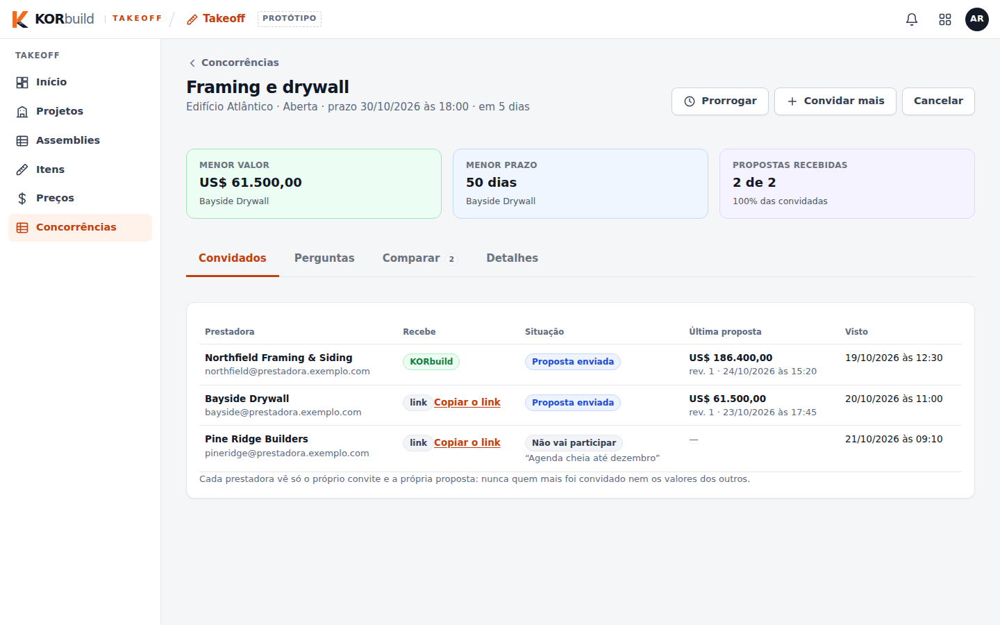{ width=100% }

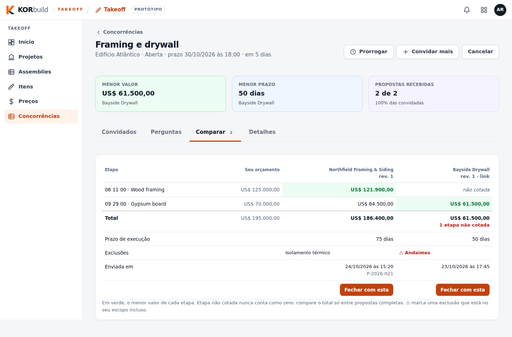{ width=100% }

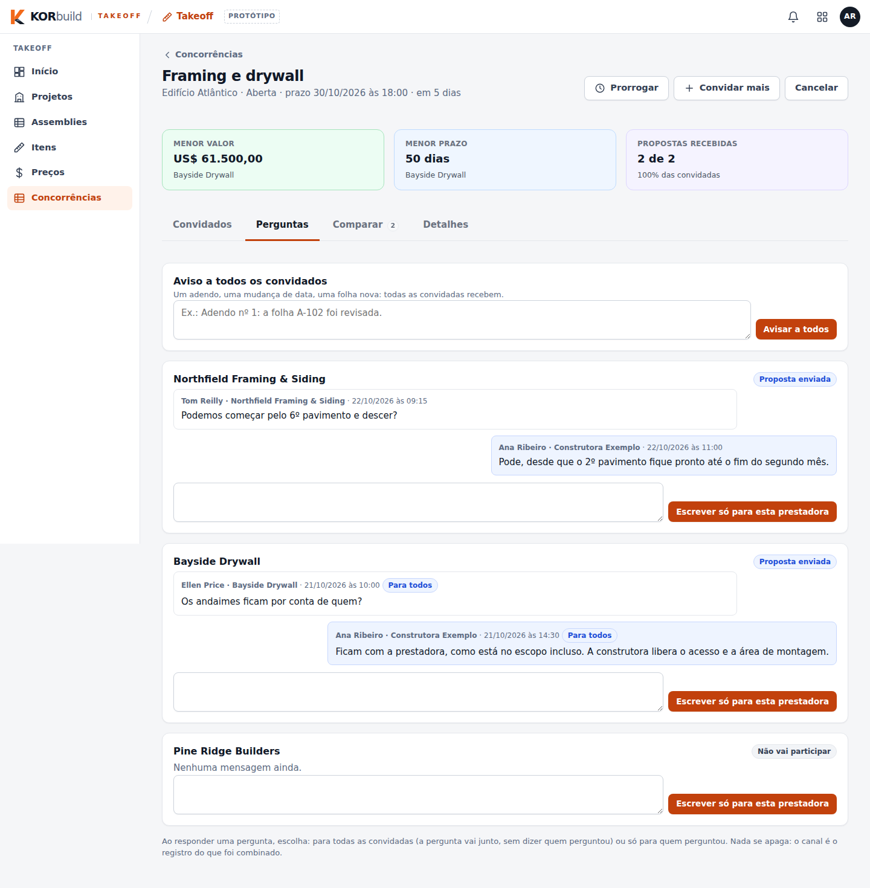{ width=100% }

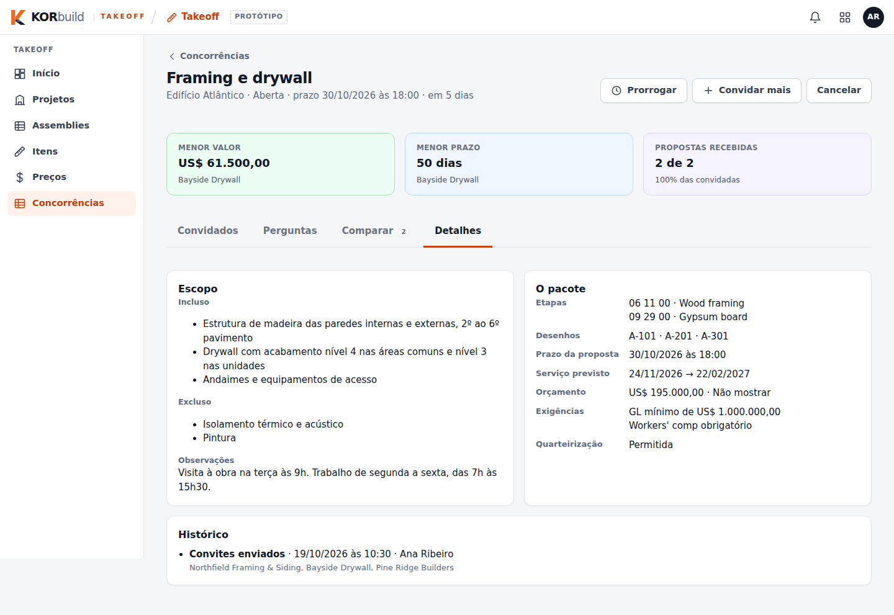{ width=100% }

**Quem recebe, com conta** — a lista de convites e a página do convite (ainda no desenho antigo).

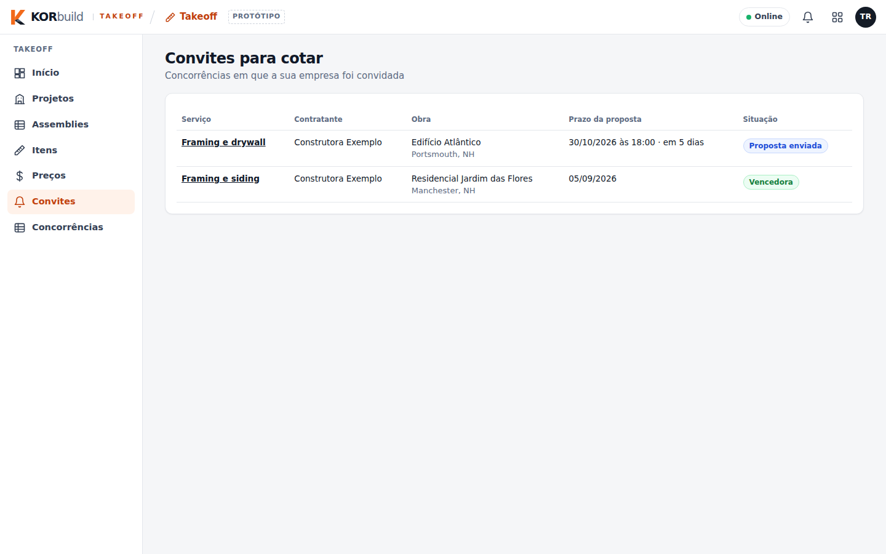{ width=100% }

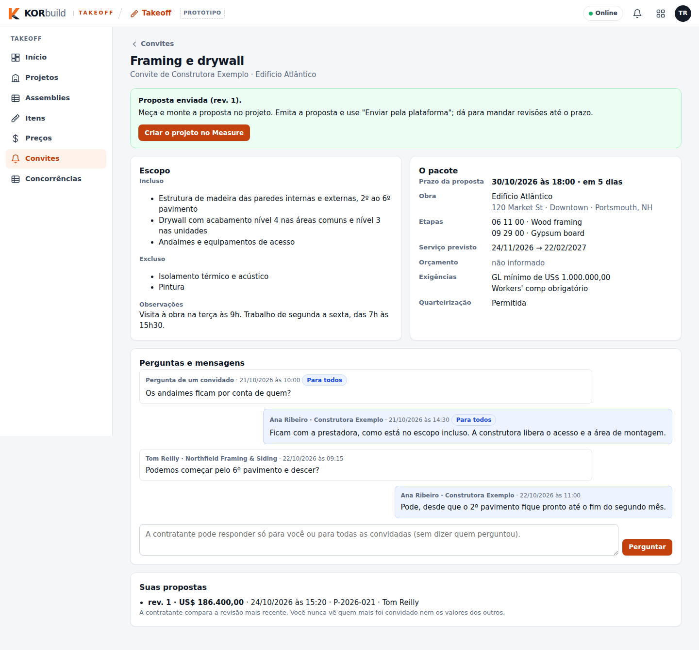{ width=100% }

**Quem recebe, sem conta (link):** o convite, os documentos com "Abrir", a proposta e as perguntas. Ver o desenho D no canvas de layouts (`Layouts das telas de Concorrência`).

## 7.4 Regras principais (resumo; a lista completa CO-01 a CO-25 está em `docs/concorrencias.md`)

| Tema | Regra |
|---|---|
| Dois caminhos | Com KOR ou sem KOR convivem; a empresa que licita escolhe (CO-01). |
| Orçamento | Mostrar é parâmetro de cada licitação: não mostrar (padrão), total ou por etapa (CO-03). |
| Privacidade | Cada prestadora só vê o próprio convite, a própria proposta e as mensagens dirigidas a ela ou a todas (CO-04, CO-22). |
| Revisões | Proposta enviada não se edita; nova proposta é revisão (rev. 1, 2…) (CO-05). |
| Envio | Exige obra ou projeto, serviço, etapa, escopo incluso, prazo no futuro e ao menos um convidado (CO-08). O Salvar também recusa prazo no passado. |
| Depois de enviar | Só prorroga, convida mais ou faz adendo; escopo e etapas não se reescrevem (CO-09). |
| Prazo | Proposta só até o prazo; depois, só se prorrogar (CO-10). |
| Comparar | Etapa sem preço é "não cotada", nunca zero (CO-12). |
| Fechar | Exige proposta enviada; registra quem, quando, valor e revisão; a concorrência fica imutável (CO-06, CO-13). |
| Vínculo | Ao fechar com prestadora com conta, o projeto dela vira Ganho e a obra nasce ligada (CO-14). |
| Cadeia | Qualquer empresa pode licitar; valores não atravessam elos (CO-19, CO-22). |
| Quarteirização | A empresa que licita define se a contratada pode quarteirizar (permitida, com aprovação, não permitida) (CO-23). |
| Licitar a partir de projeto | Pode receber propostas e usar os preços no orçamento, mas só fecha depois que o projeto é Ganho (CO-24). |

# 8. Diagnóstico: onde está a confusão

Cada item abaixo foi observado nas telas ou nos documentos; a gravidade é a minha avaliação de impacto para o usuário.

| # | Achado | Onde se vê | Gravidade | Ajuste proposto |
|---|---|---|---|---|
| 1 | **Mesmo objeto, vários nomes:** "Measure" nos textos, "Takeoff" no menu; "Concorrência", "Convite" e "Bid" para o pedido de cotação. | Menu, textos como "Criar o projeto no Measure" | Alta | Vocabulário fechado (cap. 2), menu aplicado; falta o corpo das telas |
| 2 | **Dois menus para a mesma coisa:** "Convites" (recebidos) e "Concorrências" (enviadas). | Menu lateral | Alta | **Aplicado:** um item **Bids** com abas **Sent** e **Received** |
| 3 | **"Contratante" tem dois sentidos:** no projeto, quem pediu a *minha* proposta; na licitação, quem convida. | Cadastro do projeto e formulário da licitação | Alta | No projeto, **Cliente (quem pediu a proposta)**; "Dono da obra" vira link opcional; na licitação, "Quem licita" |
| 4 | **A licitação pede "Obra" logo no início,** mas no momento do orçamento a obra ainda não existe. | Formulário Nova concorrência | Média | A origem natural é o **projeto**; "Obra" só quando a licitação nasce de uma obra já ganha |
| 5 | **Dois caminhos de resposta para a prestadora com conta:** proposta emitida no Takeoff ("Enviar pela plataforma") ou, pelo link, PDF e total direto. | Convite recebido vs link | Média | Permitir também o envio simples (PDF e total) para quem tem conta |
| 6 | **Tela do convite recebido ainda no desenho antigo** e mistura estados ("Proposta enviada" com o botão "Criar o projeto no Measure"). | Convite | Média | Aplicar o desenho D e separar os estados |
| 7 | **Documentos em dois lugares:** as folhas do projeto e os anexos da licitação. | Projeto e formulário | Média | Uma única lista, com a opção de marcar as plantas do projeto |
| 8 | **Cronograma só na obra,** depois de ganhar. | Fluxo | Média | Preliminar no projeto, confirmado no ganho (cap. 9) |
| 9 | **Sem licitação "por fora" do KOR** (pacote e registro manual) e **sem aceite**. | Fluxo 4b e 5 | Alta | Cap. 9, itens 3 e 4 |
| 10 | **Visão gerencial da prestadora incompleta:** a empresa que licita não vê o andamento do projeto dela. | Fluxo 8 | Média | Mostrar só o status do projeto, nunca custo ou margem |

# 9. Proposta de ajuste (ordem sugerida)

| Ordem | Ajuste | Esforço | Efeito |
|---|---|---|---|
| 1 | **Vocabulário e menu:** nomes do capítulo 2, menu único "Licitações" com Enviadas e Recebidas. | Baixo | Remove a maior parte da confusão |
| 2 | **Cadastro do projeto:** "Cliente" e "Dono da obra (opcional)"; texto de ajuda curto; preenchimento automático quando o projeto nasce de um convite. | Baixo | Resolve o item 3 |
| 3 | **Pacote para e-mail e registro manual:** baixar o pacote (PDF e escopo) e registrar a resposta recebida por fora, entrando na mesma comparação. | Médio | Fecha o caminho 4b e traz as propostas "por fora" |
| 4 | **Aceite:** responder "aceito" ao valor ou à participação, sem proposta nova (definir qual). | Baixo a médio | Fecha o fluxo de licitação de preço fechado |
| 5 | **Convite recebido no desenho D** e envio simples para quem tem conta. | Médio | Itens 5 e 6 |
| 6 | **Exportar para Excel** (quantidades, materiais, comparação). | Médio | Prioridade já definida por você; esperada pelo mercado |
| 7 | **Cronograma preliminar no projeto,** com duração por etapa nas respostas e confirmação no ganho. | Alto | Item 8; diferencial real |
| 8 | **Visão gerencial:** status do projeto da prestadora, para quem licita. | Médio | Item 10 |
| 9 | **Biblioteca inicial de itens e assemblies** e importação de preços. | Médio a alto | Reduz o tempo até o primeiro orçamento |

**Fora da 1ª versão (sugestão):** IA de detecção automática, comparação de revisões de planta, pré-qualificação de prestadoras, publicação em bid boards públicos, integração contábil.

# 10. Decisões abertas

1. O **aceite** é de valor, de participação, ou dos dois?
2. A visão gerencial da prestadora mostra só o **status** do projeto?
3. A empresa pode licitar **só parte do projeto (por etapa)** a prestadoras diferentes? (O motor já aceita etapas.)
4. O **cronograma preliminar** entra na 1ª versão ou na segunda?
5. A prestadora responde a **duração por etapa**, ou um prazo total basta?
6. "Licitação / Bid" e "Cliente / Dono da obra": confirma o vocabulário do capítulo 2?
7. A observação de cada anexo e os vários anexos na proposta exigem **migração do banco** (a aprovar quando você decidir).

# 11. Rastreabilidade

| Assunto | Documento | Testes |
|---|---|---|
| Medição, assemblies, preços | `docs/measure.md` (MZ-01 a MZ-33) | `tests/measure.test.mjs` |
| Licitações | `docs/concorrencias.md` (CO-01 a CO-25) | `tests/concorrencias.test.mjs`, `tests/concorrencias-oficial.test.mjs` |
| Cronograma | `docs/cronograma.md` | `tests/cronograma.test.mjs` |
| Homologação 1ª versão | `docs/testes/lista-checagem-primeira-versao.md` (T01 a T194) | `tests/homologacao-pv.test.mjs` |
| Capturas deste documento | `tools/capturas-modulos.mjs` | (refazer quando as telas mudarem) |
